# Resonance

Measure cable tension and vibration from a phone video, and refuse, with the reason, whenever the physics does not check out.

**Live demo:** _link added after deployment_ · **3-minute video:** _link added at submission_

Built for the Meta Global AI Developer Hackathon (Oct 26 – Nov 4, 2026). Everything in this repository was written during the event. Built with Muse Spark Open and SAM 3.1 (Meta). Screening tool: it does not certify structures; an engineer signs every report.

## Meta models, and the job each one does

| Model | Where it runs | Job |
|---|---|---|
| **SAM 3.1** | on the laptop through MLX (Apple silicon, no network, which matters at a remote bridge), or the Meta Model API | finds every cable from a noun phrase; each mask becomes a centre line of virtual sensors |
| **Muse Spark Open** | Baseten | three separate jobs: **(1)** looks at the frame with each SAM candidate highlighted and rejects what is not a tensioned member; **(2)** the inspection agent that writes the report from tool calls only; **(3)** a separate call, given only the evidence and the field notes, that checks every claim and fails closed |

```mermaid
flowchart LR
  V[Phone video] --> C[Clip check: true fps, timing, camera, resolvable band]
  C --> S[SAM 3.1 finds the cables]
  S --> R[Muse Spark Open: is this really a tensioned cable?]
  R --> P[Physics: harmonic ladder, mode shapes, alias guard, camera gate]
  P -->|verified / provisional / refused| A[Muse Spark Open agent writes the report]
  A --> K[Code rules: no number on a refused cable, never 'safe']
  K --> F[Muse Spark Open verifier checks every claim]
  F --> E[Engineer signs: hash of the evidence]
```



## How it works

1. **Timing.** Frame times come from the container's per-frame timestamps, never the nominal frame rate, so slow-motion files with drifting or relabelled rates still give true frequencies.
2. **Sensors.** SAM 3.1 finds the cables from a noun phrase ("rope", "cable"); each mask is reduced to its axis and thickness. It runs on the laptop through MLX (no network, which matters at a remote bridge) or through the Meta Model API. SAM also finds floor leads, frame bars and handrails, so **Muse Spark Open looks at the frame with each candidate highlighted** and answers a narrower question: is this a tensioned member, and are both supports in view? Rejected candidates are not measured unless the person filming keeps them, and the verdict travels into the report. Each cable is a line of stations. At every station the cross profile is sampled and the cable's position is tracked to a fraction of a pixel. Camera shake is measured on a static anchor (phase correlation, upsampled DFT) and removed along each cable's normal.
3. **Spectrum.** Displacement from all stations is combined into one spectrum; peaks are found against a running noise floor.
4. **Self-checks.** A taut cable rings at `f_n = n f0 sqrt(1 + B n^2)`. A result is *verified* only if the strong peaks sit on one such ladder, the fundamental's mode shape has no interior node (and the 2nd has one), the frame rate is high enough for a coarse frequency prior (the alias guard), and the frame timing is steady. Otherwise it is *provisional* (labelled, with a re-shoot request) or *refused* with the reason.
5. **Physics.** Taut string with pinned ends: `T = 4 m L^2 f0^2`, with propagated uncertainty and a pinned/clamped bracket when end fixity matters. Members whose bending stiffness is significant (`xi < 10`) get relative comparisons only.
6. **Agent.** An inspector agent (Muse Spark Open on Baseten; Muse Spark on the Meta Model API is a drop-in provider) writes the report from tool calls; code enforces the rules (no numbers on refused members, provisional labelled, no "safe", no absolute field tension); a separate Muse Spark Open call, given only the evidence and the field notes, verifies every claim and fails closed; an engineer signs off, bound to a hash of the evidence.
7. **Field mode.** Main-cable sag from the fitted curvature and the sway frequency `sqrt(g / 8b)` are two independent readings of the same cable.

## Status

| Piece | State |
|---|---|
| Timing, tracking, shake removal, spectrum, verifiers, tension | working; synthetic bench: 5/5 ropes within 0.02% at 240 fps, all refused at 30 fps |
| Inspection agent + independent verifier + approval | working on Muse Spark Open (Baseten) |
| Field mode (sag, sway frequency) | working on a synthetic footbridge |
| SAM 3.1 member detection | **on-device (MLX, Apple silicon): working**, 2–8 s per prompt; robust mask → centre-line fit, duplicates merged; finds the hangers of a Nepal footbridge and the wind-tunnel cable model, and the measurement from its member matches the hand-placed one. Meta Model API client written against the documented wire format, not yet run live |
| Visual review of candidates (Muse Spark Open, image input) | working: on the wind-tunnel clip it rejects the base frame and floor leads SAM proposed, and confirms the cable model when given the site notes; fails closed to "unreviewed" |
| Real phone footage | not yet tested |

## Validation on real footage (independent ground truth)

| Clip | Ground truth | Resonance |
|---|---|---|
| Cello G string, 7000 fps, two takes (Mores & Plath 2018, CC BY 4.0) | T = m v² = 108.8 N (6.15 g/m, 133 m/s), f0 ≈ 98 Hz | high bow force: verified 18-rung ladder, f0 96.51 Hz, **T = 105.9 ± 2.6 N (−2.6%)**; low bow force: 16 rungs, f0 96.64 Hz, **T = 106.2 ± 2.6 N (−2.4%)**; takes agree within 0.3% |
| Oak tree sway, 30 fps (Ammatelli et al. 2023, CC BY 4.0) | accelerometer 0.23–0.24 Hz | 0.234 Hz (sideways), 0.245 Hz (vertical) |
| Bridge-cable model in a wind tunnel, 30 fps (Trush et al., Zenodo 15655246, CC BY 4.0) | accelerometers: f1 ≈ 5 Hz (free decay 5.07 Hz); mode-2 lock-in 9.55 Hz | clip "mode 1": mode 1 by shape, f0 4.96 Hz; clip "mode 2": mode 2 by shape at **9.57 Hz** (+0.2%); clips "mode 3/4": **refused** (aliased at 30 fps); with the member placed by **SAM 3.1** ("horizontal bar", score 0.87) instead of by hand: identical (4.961 Hz mode 1; 9.57 Hz mode 2) |
| Shaking-table structure, free decay, 62 fps (Mendeley njhcj2kphr, CC BY 4.0) | laser 4.8467 Hz | **4.832 Hz** (−0.3%) |
| High-speed guitar, 600 fps (MIT EVM) | E2 82.41 Hz, A2 110 Hz | 81.0 / 108.5 Hz (−1.7% / −1.4%) by spectrum; tool refuses to certify (0.5 s clip, partial strings, no ladder) |
| Footbridge with runners crossing, 24 fps (Pexels) | not measurement-grade | **refused**: the camera itself moves (55 px RMS, measured away from the deck) and runners pass in front of it |
| Footbridge, drifting handheld camera, 60 fps (Pexels) | not measurement-grade | **refused**: camera moved 24 px RMS, film from a tripod |
| Slackline with a walker, 25 fps (Pexels) | mass-on-rope, not a free string | **refused** as a cable (no harmonic ladder); bounce at ~1.0 Hz |

Reproduce: `python scripts/validate_real.py` and `python scripts/validate_datasets.py`. The clips are not in this repository; download them from the sources above and point `RESONANCE_FOOTAGE` / `RESONANCE_DATASETS` at the folders.

## Prior work

Measuring cable tension from video is established: vision-based frequency identification and automatic frequency sieving (e.g. Wu et al. 2023, doi:10.1155/2023/9343343; Sensors 2021, doi:10.3390/s21217229), reliability under camera shake (Xu et al. 2026, doi:10.1016/j.measurement.2026.121753), and camera-based tension products (RDI Technologies; see also US 11538173 B1 and US 11972577 B1 on recording at a second frame rate). Resonance's focus is different: physics gates that decide when to refuse, an agent that writes the report from tool calls, an independent verifier, and change detection against a baseline. Gate thresholds are frozen in [GATES.md](GATES.md).

Known limits: shake removal is translation-only (camera-coincident peaks are removed); sag assumes a roughly fronto-parallel view.

## Choosing the SAM 3.1 prompt

The noun phrase matters more than the score threshold. Measured on real frames: footbridge hangers, "suspension cable" or "vertical cable" (0.5–0.6, 19 hangers on one frame) rather than "cable" (about 0.3, unstable from frame to frame); a thick wind-tunnel cable model, "horizontal bar" (0.87) or "rod"; "hanger", "suspender", "steel wire" and "bridge cable" found nothing. Whatever SAM proposes is then reviewed by Muse Spark Open before it is measured.

## Try it

```bash
export PYTHONPATH=src
python -m resonance.cli serve                      # web app on http://127.0.0.1:8765
python -m resonance.cli serve --host 0.0.0.0      # same, reachable from a phone on your Wi-Fi (no login)
python -m resonance.cli check clip.mov             # before measuring: true fps, timing, shake, exposure
python -m resonance.cli detect clip.mov --concept rope   # SAM 3.1 members + overlay (set RESONANCE_SAM_PYTHON for on-device)
python -m resonance.cli synth media/bench240.mp4 --fps 240
python -m resonance.cli analyze media/bench240.mp4 --truth media/bench240.mp4.json --hero
python -m resonance.cli inspect out/run --context @notes.txt --mode bench
python -m resonance.cli confirm out/take240 out/take120 --out out/confirmed   # second-take alias guard
python -m resonance.cli approve out/run --by "Engineer Name"
python -m pytest -q
```

Members on the command line: `name:x0,y0,x1,y1:L=1.8:m=0.022:T=5-300` (pixels, metres, kg/m, plausible tension range in N).

Requires Python 3.12, numpy, scipy, Pillow and ffmpeg.

On-device SAM 3.1: create a separate Python environment with `pip install "mlx-vlm>=0.4.3"`, download `mlx-community/sam3.1-bf16`, and set `RESONANCE_SAM_PYTHON` (that environment's python) and `RESONANCE_SAM_MODEL` (the model folder) in `.env`. Without it, detection uses the Meta Model API (`MODEL_API_KEY`).

## Hosted demo

`deploy/modal_app.py` serves the app from one Modal container: `RESONANCE_SAMPLES_DIR=/path/to/samples modal deploy deploy/modal_app.py`. The samples folder holds `samples.json` and its clips, SAM 3.1 results computed on-device for those clips (`sam_cache/`), and finished runs to replay (`runs/`, `replays.json`). With `RESONANCE_PUBLIC=1` the server caps model calls per hour and upload size; the model key comes from the Modal secret `resonance-keys`.
